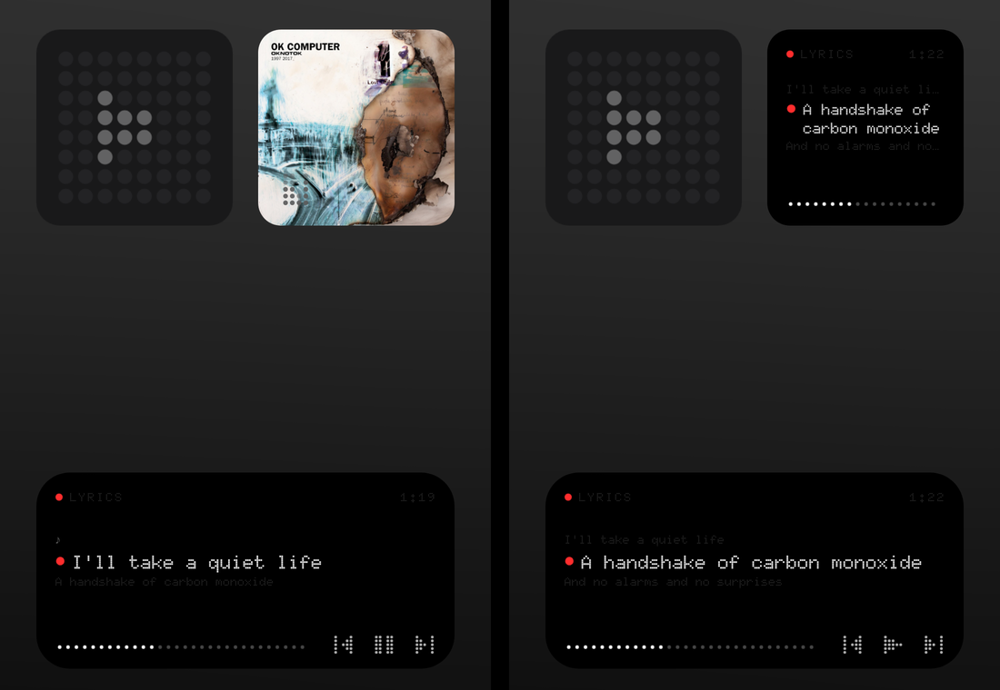

# Nothing Widgets

Dot-matrix home-screen widgets for Nothing phones (built on a Phone (3a) Lite, works on any Android 8+ phone; swipes and tap-to-seek need Android 12+).



## Widgets

**Lyrics** - synced lyrics for whatever is playing in any music app, fetched from [LRCLIB](https://lrclib.net).
Word-by-word karaoke fill when the lyrics have word timings, previous/next lines for context, ⏮ ⏯ ⏭ buttons,
tap a line to jump to it. Per-song timing offset and a lyrics picker in the app. Save lyrics to keep them for good,
or export them as a `.lrc` file. Resizes freely.

**Artwork** - the album cover with Nothing's little animated dot eq while playing.
- swipe left / right: next / previous track (the card follows your finger)
- swipe up: lyrics, swipe down: back to the cover
- tap: pause / play
- long-press: the launcher's resize / remove menu

Home-screen widgets can only receive taps, so the swipes come from an optional accessibility service
("Nothing Widgets swipes") that lays an invisible touch layer over this one widget while the home screen is showing.
It reads nothing else. Without it, tapping still pauses.

**Visualizer** - cava-style dot visualizer of what the phone is playing (dots or bars, white or red, 8-16 bands, peak caps).
Uses the audio output mix, not the microphone. 2×2 and up.

**Cache** - covers and lyrics of songs you played are kept so they show instantly and offline. Each has its own size cap
(slider, default 75 MB covers / 10 MB lyrics, far right = unlimited); the least recently played go first.
Songs LRCLIB has no lyrics for are searched again after 7 days (1 / 3 / 7 / 30 / off). Saved lyrics never count or expire.

## Install

Download the APK from [Releases](../../releases) and open it on the phone. Then in the app:
1. **Notification access** - needed to see what's playing (lyrics, artwork).
2. **Audio** - only for the visualizer.
3. **Enable swipes** - optional, for the artwork widget gestures.

If a permission toggle is greyed out: App info › ⋮ › Allow restricted settings.

## Build

Needs JDK 17 and the Android SDK (platform 35).

```sh
./gradlew assembleDebug            # app/build/outputs/apk/debug/app-debug.apk
./gradlew testDebugUnitTest
adb install -r app/build/outputs/apk/debug/app-debug.apk
```

Release builds are signed with a key that is not in the repo (`release.jks` + `NW_STORE_PASSWORD` / `NW_KEY_PASSWORD`
in `~/.gradle/gradle.properties`). The eq animation is generated: edit and run `tools/gen_eq.py`.

## License

LGPL-3.0, see [COPYING.LESSER](COPYING.LESSER) and [LICENSE](LICENSE).
The bundled [Doto](https://github.com/oliverlalan/Doto) font is under the SIL Open Font License 1.1 ([fonts/OFL.txt](fonts/OFL.txt)).
Not affiliated with Nothing Technology.
